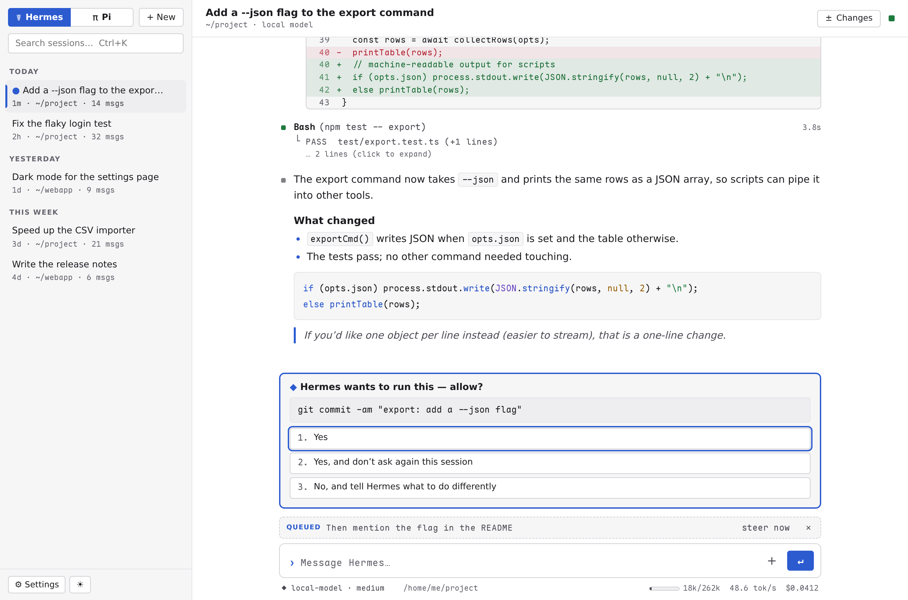
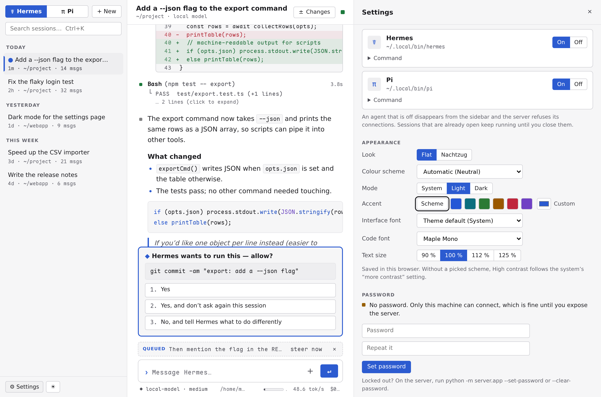
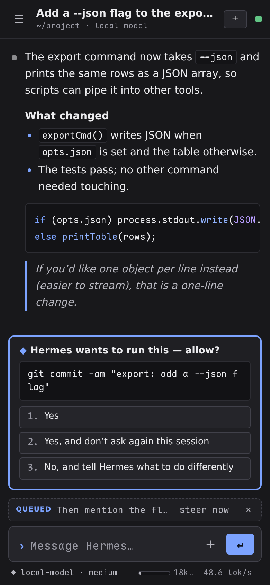

# Stellwerk

**A web UI for the Hermes and Pi coding agents, in your browser and on your phone.**

Stellwerk is a small server you run on your own machine. It gives the [Hermes](#what-are-hermes-and-pi) and [Pi](#what-are-hermes-and-pi) terminal coding agents a chat-style interface with streaming output, tool calls, diffs and approvals, so you can keep working with them from any browser.

*A Stellwerk is a railway signal box: the room where the switches are set that send each train down the right track.*



- [What are Hermes and Pi?](#what-are-hermes-and-pi)
- [Features](#features)
- [Quick start](#quick-start)
- [Security](#security)
- [Configuration](#configuration)
- [Keyboard shortcuts](#keyboard-shortcuts)
- [FAQ and troubleshooting](#faq-and-troubleshooting)
- [Contributing](#contributing)

## What are Hermes and Pi?

They're two independent, open-source coding agents that run in your terminal. Stellwerk doesn't replace them; it's another window onto the same agents, sessions and settings.

- **[Hermes Agent](https://github.com/NousResearch/hermes-agent)** by [Nous Research](https://nousresearch.com) is a self-improving agent with skills, memory, subagents and a long-running gateway. [Docs](https://hermes-agent.nousresearch.com/docs/).
- **[Pi](https://pi.dev)** by Mario Zechner is a deliberately minimal coding agent that you extend with TypeScript extensions. [Source](https://github.com/earendil-works/pi).

You need at least one of them installed. Stellwerk is a separate project and isn't affiliated with either.

## Features

**Both agents, one UI**

- Use Hermes, Pi, or both. With both on, a ☤ Hermes / π Pi switch sits at the top of the sidebar.
- Turn either agent off in Settings, or point Stellwerk at an agent installed somewhere unusual.

**A transcript you can follow**

- Replies stream in as they're written.
- Tool calls show up as `Bash(…)`, `Read(…)` and `Update(…)`, with diffs inline. Click one to see its arguments and output.
- Reasoning appears in collapsible blocks.
- When an agent needs you, approval and clarify prompts (and Hermes' sudo and secret prompts, or Pi's extension dialogs) appear as cards above the composer.

**A composer that keeps up**

- `/` completes slash commands and `@` completes file paths.
- Keep typing while a turn runs: your messages queue up, and you can use them to steer the agent mid-turn.
- Paste or drop images and files to attach them.
- Edit an earlier message to take the conversation in a new direction.

**Everything at a glance**

- Pick the model and reasoning effort from the status line, which also shows the working folder, context use, cost and tokens per second.
- **± Changes** shows what the session changed as a diff. With Hermes you can also view and restore checkpoints.
- **⑂ Subagents** shows the work an agent handed off to subagents.
- Search your conversations (titles and message text, with the matching snippet), and delete the sessions you don't need. Long lists and long sessions load a page at a time, so it stays quick.
- Click the cost or tokens-per-second readout for **Usage**: this session and all time, by day, week, month and model, split into input, output, cache reads, cache writes and reasoning tokens.

**Made to be comfortable**

- Two themes. **Flat** is the default, with colour schemes, high-contrast light and dark modes, an accent colour, a choice of fonts and adjustable text size. **Nachtzug** is a warmer, bookish alternative.
- Works on a phone: the layout, the controls and the keyboard behaviour adapt.
- Accessibility is a goal, not an afterthought: everything works from the keyboard, the transcript is labelled for screen readers, and the themes are checked for contrast.

**Settings in the app**

- One drawer (**⚙ Settings**, or Ctrl+,) for turning agents on and off, setting their paths, setting, changing or removing the password, and signing out other browsers.

<p align="center">
  
  &nbsp;
  
</p>

## Quick start

You need:

- Linux or macOS (development happens on Linux),
- Python 3.10 or newer,
- [Hermes](https://hermes-agent.nousresearch.com/docs/) or [Pi](https://pi.dev) installed and working in your terminal. Stellwerk looks for `hermes` and `pi` on your `PATH`, then in `~/.local/bin`.

Pick one of these three ways to run it.

### 1. From source

```sh
git clone https://github.com/mjohanning99/stellwerk ~/stellwerk
cd ~/stellwerk
python3 -m venv .venv
.venv/bin/pip install -r requirements.txt
.venv/bin/python -m server.app
```

Open <http://127.0.0.1:7777>. That's it.

### 2. Docker Compose

The image contains only Stellwerk. It runs as your user, with your home folder mounted, so it can use the agents you've already installed. If you use Hermes, start its gateway on the host first.

```sh
git clone https://github.com/mjohanning99/stellwerk && cd stellwerk
hermes gateway install            # Hermes users: run the gateway as a host service
cp .env.example .env              # then set UID, GID and USER (id -u; id -g; echo $USER)
docker compose up -d --build
```

Open <http://127.0.0.1:7777>. Linux only. The container can do anything your user can, by design. [docs/docker.md](docs/docker.md) explains why it's set up this way, what runs where, and how to add tools for Pi.

### 3. As a systemd user service

To keep it running in the background and start it when you log in, do the source install above, then:

```sh
cp contrib/stellwerk.service ~/.config/systemd/user/
systemctl --user daemon-reload
systemctl --user enable --now stellwerk
```

If you cloned somewhere other than `~/stellwerk`, edit `WorkingDirectory` and `ExecStart` in the unit first. To keep it running after you log out, run `sudo loginctl enable-linger $USER`. Logs: `journalctl --user -u stellwerk -f`.

### First steps

1. Open **⚙ Settings** (Ctrl+,). Check that the agents you want are on.
2. If you'll reach Stellwerk from anywhere other than this machine, **set a password** there first.
3. Click **+ New**, pick a working folder and start talking.

## Security

Stellwerk runs coding agents, and coding agents run commands. **Anyone who can use Stellwerk can run commands as your user.** The defaults are built around that:

- **It listens on `127.0.0.1` only.** Nothing else on your network can reach it until you change `STELLWERK_HOST`.
- **The password is optional, and it's off by default.** That's fine while only your own machine can connect. Without a password, the server only answers requests addressed to an IP address, `localhost` or this machine's name. That stops a malicious web page from reaching it through [DNS rebinding](https://en.wikipedia.org/wiki/DNS_rebinding). If you use another host name, add it to `STELLWERK_ALLOWED_HOSTS`.
- **Settings warns you** when there's no password and the server can be reached from the network.

To use it from your phone or another computer, the easiest safe option is [Tailscale](https://tailscale.com):

```sh
tailscale serve --bg 7777
```

This gives you `https://<machine>.<tailnet>.ts.net`, with HTTPS, reachable only by your own devices. **Set a password anyway** as a second lock: it also protects you if someone else on your tailnet, or a device you lose, can open the page.

If you do listen on a LAN address instead, set a password first, and remember that the connection isn't encrypted.

Passwords are stored as scrypt hashes in `~/.config/stellwerk/config.json`. Changing the password, or clicking **Sign out other browsers**, signs out every other browser.

## Configuration

Most settings live in the app's Settings drawer and are saved to `~/.config/stellwerk/config.json`. Themes and other display preferences are saved per browser.

### Environment variables

| Variable | Default | What it does |
|---|---|---|
| `STELLWERK_HOST` | `127.0.0.1` | Addresses to listen on, comma-separated, e.g. `127.0.0.1,192.168.1.20` |
| `STELLWERK_PORT` | `7777` | Port to listen on |
| `STELLWERK_CONFIG` | `~/.config/stellwerk` | Folder for `config.json` (password hash, agent settings) |
| `STELLWERK_ALLOWED_HOSTS` | (none) | Extra host names to accept in password-less mode, comma-separated |
| `STELLWERK_PROXY_ORIGINS` | `.ts.net` | Domain suffixes, comma-separated, whose HTTPS origins are trusted from a reverse proxy on loopback (such as `tailscale serve`) |
| `STELLWERK_UPLOADS` | `~/.cache/stellwerk/uploads` | Where attached files are stored for the agents to read |
| `STELLWERK_TRASH` | `~/.cache/stellwerk/trash/pi` | Where deleted Pi sessions go (Pi has no delete command, so they're moved, not erased) |
| `PI_SESSIONS_DIR` | `~/.pi/agent/sessions` | Where to look for Pi's sessions |

### Command-line options

Run these as `python -m server.app <option>` (`.venv/bin/python` in a source install).

| Option | What it does |
|---|---|
| `--host ADDRS` | Same as `STELLWERK_HOST` |
| `--port N` | Same as `STELLWERK_PORT` |
| `--set-password` | Set the password and exit. Signs out every browser. |
| `--password-stdin` | With `--set-password`: read the password from stdin instead of prompting |
| `--clear-password` | Remove the password and exit, e.g. if you're locked out |
| `--revoke-sessions` | Sign out every browser and exit |
| `--version` | Print the version |

These work while the server is running too: it notices the change to `config.json` and picks it up.

## Keyboard shortcuts

| Keys | What it does |
|---|---|
| Enter | Send (or queue, while a turn runs) |
| Shift+Enter | New line |
| Esc | Interrupt the running turn, cancel an edit, or close a popup or drawer |
| ↑ in an empty composer | Recall your last message |
| Tab / Shift+Tab, ↑ / ↓, Ctrl+N / Ctrl+P | Move through `/` and `@` completions |
| Enter in a completion | Accept it (a slash command runs right away; Alt+Enter only inserts it) |
| Ctrl+K | Search sessions |
| Ctrl+Alt+N | New session |
| Ctrl+, | Open or close Settings |

On a Mac, Cmd works in place of Ctrl. On a phone, Enter adds a new line; use the ↵ button to send.

## FAQ and troubleshooting

**Do I need both agents?**
No. Stellwerk works with either one. An agent that isn't installed is simply hidden, and you can turn off one that is.

**Hermes or Pi shows as "not installed".**
Stellwerk looks on its `PATH`, then in `~/.local/bin`. Services often get a shorter `PATH` than your shell. Set the full path to the agent under **Settings → Agents**, or add its folder to `PATH` in the service file.

**The Hermes view says the gateway isn't ready.**
Stellwerk connects through the Hermes gateway and starts it if needed. Run `hermes gateway status` in a terminal to see what's wrong. In Docker, the gateway must already be running on the host ([why](docs/docker.md#hermes-and-the-gateway)).

**"… is not an allowed host name".**
You opened Stellwerk by a host name while no password is set. Open it by IP address, set a password, or add the name to `STELLWERK_ALLOWED_HOSTS`.

**I forgot my password.**
Run `python -m server.app --clear-password` on the server (it can keep running), then set a new one in Settings.

**Port 7777 is taken.**
Set `STELLWERK_PORT` (or `--port`) to something else.

**Where's my data?**
Your sessions stay with the agents (`~/.hermes` and `~/.pi`), exactly where the terminal versions keep them. Stellwerk itself only stores its settings in `~/.config/stellwerk` and attachments in `~/.cache/stellwerk`.

**Does it work on Windows?**
It hasn't been tried. Hermes recommends WSL2 on Windows, and running Stellwerk inside WSL2 is probably the best bet.

## Contributing

Bug reports, ideas and pull requests are welcome. Please open an issue first for anything big, so we can agree on the approach before you spend time on it.

Stellwerk is deliberately small: one Python dependency (aiohttp), plain JavaScript modules, and no build step. Edit a file and reload the page. [docs/development.md](docs/development.md) covers the layout, the protocol references for both agents, and the end-to-end tests.

## Acknowledgements

- [Hermes Agent](https://github.com/NousResearch/hermes-agent) and [Pi](https://pi.dev), the agents this is a window onto.
- [marked](https://github.com/markedjs/marked) (MIT), [DOMPurify](https://github.com/cure53/DOMPurify) (Apache 2.0 / MPL 2.0) and [highlight.js](https://github.com/highlightjs/highlight.js) (BSD 3-Clause), vendored under `web/vendor/`.
- The fonts Maple Mono, Inter, Atkinson Hyperlegible, JetBrains Mono, Nachtzug Grotesk, Nachtzug Antiqua and EB Garamond, bundled under the SIL Open Font License (see `web/fonts/OFL-*.txt`).

## License

MIT, see [LICENSE](LICENSE). The bundled fonts are under the SIL Open Font License, and the vendored libraries under their own licenses (see [Acknowledgements](#acknowledgements)).
